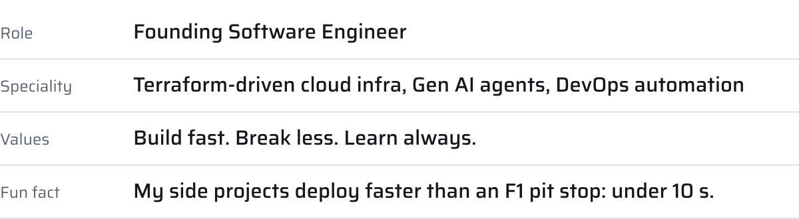
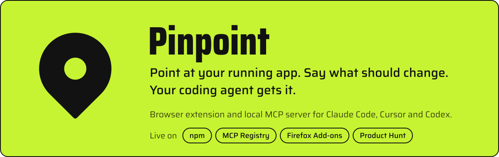
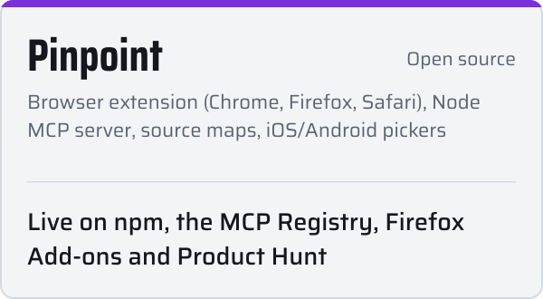
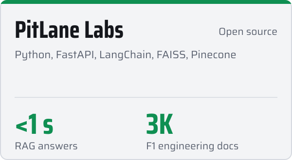
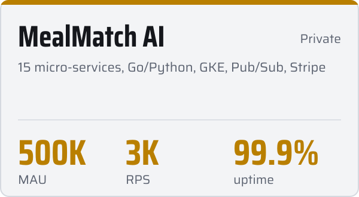
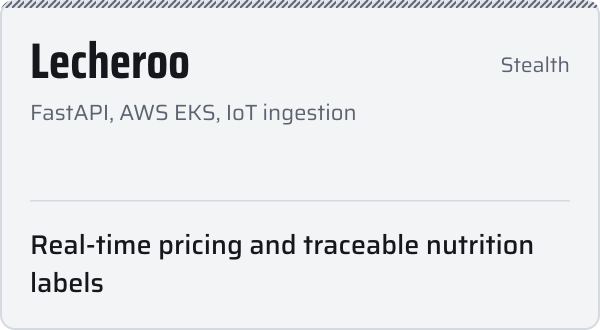
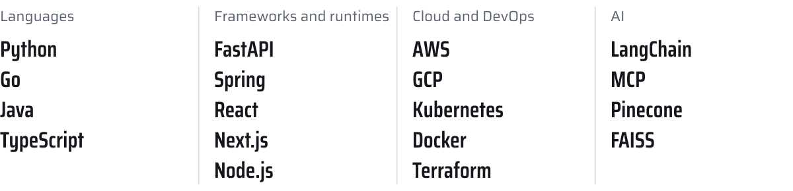
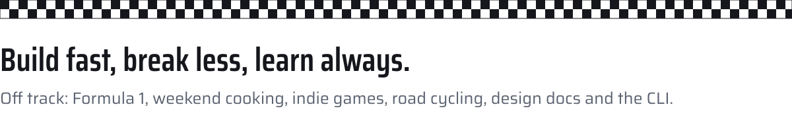

<!-- Visual assets are generated by assets/build.mjs (design notes: assets/DESIGN.md). -->
<picture><source media="(prefers-color-scheme: dark)" srcset="assets/hero-dark.svg"/></picture>

<a href="https://www.linkedin.com/in/gowtham-kumar-solleti/"><picture><source media="(prefers-color-scheme: dark)" srcset="assets/btn-linkedin-dark.svg"/></picture></a>
<a href="https://gowtham012.github.io/Portfolio-main/"><picture><source media="(prefers-color-scheme: dark)" srcset="assets/btn-portfolio-dark.svg"/></picture></a>
<a href="https://x.com/SolletiKumar"><picture><source media="(prefers-color-scheme: dark)" srcset="assets/btn-x-dark.svg"/></picture></a>
<a href="mailto:gouthamsolleti3@gmail.com"><picture><source media="(prefers-color-scheme: dark)" srcset="assets/btn-email-dark.svg"/></picture></a>
<a href="https://github.com/gowtham012/ME/blob/main/gk4.pdf"><picture><source media="(prefers-color-scheme: dark)" srcset="assets/btn-resume-dark.svg"/></picture></a>

<picture><source media="(prefers-color-scheme: dark)" srcset="assets/h-about-dark.svg"/></picture>

<picture><source media="(prefers-color-scheme: dark)" srcset="assets/about-dark.svg"/></picture>

<picture><source media="(prefers-color-scheme: dark)" srcset="assets/h-flagship-dark.svg"/></picture>

<a href="https://github.com/gowtham012/PinPoint"><picture><source media="(prefers-color-scheme: dark)" srcset="assets/pinpoint-dark.svg"/></picture></a>

Click an element on your local dev site, type what should change, and Claude Code, Cursor or Codex gets the selector, styles, React/Vue component, source file (even on minified builds) and a crop. It asks before it guesses, shows before/after, and works on the iOS Simulator and Android emulator too. Open source, runs entirely on your machine.

    

[Website](https://gowtham012.github.io/PinPoint/) &nbsp;&nbsp; [GitHub](https://github.com/gowtham012/PinPoint) &nbsp;&nbsp; [Show HN](https://news.ycombinator.com/item?id=50185443)

<picture><source media="(prefers-color-scheme: dark)" srcset="assets/h-projects-dark.svg"/></picture>

<a href="https://github.com/gowtham012/PinPoint"><picture><source media="(prefers-color-scheme: dark)" srcset="assets/card-pinpoint-dark.svg"/></picture></a>
<a href="https://github.com/gowtham012/PitLane-Labs"><picture><source media="(prefers-color-scheme: dark)" srcset="assets/card-pitlane-dark.svg"/></picture></a>

<picture><source media="(prefers-color-scheme: dark)" srcset="assets/card-mealmatch-dark.svg"/></picture>
<picture><source media="(prefers-color-scheme: dark)" srcset="assets/card-lecheroo-dark.svg"/></picture>

<picture><source media="(prefers-color-scheme: dark)" srcset="assets/h-garage-dark.svg"/></picture>

<picture><source media="(prefers-color-scheme: dark)" srcset="assets/garage-dark.svg"/></picture>

<picture><source media="(prefers-color-scheme: dark)" srcset="assets/h-telemetry-dark.svg"/></picture>

<picture><source media="(prefers-color-scheme: dark)" srcset="https://github-readme-stats.vercel.app/api?username=gowtham012&show_icons=true&hide_rank=true&card_width=495&border_radius=14&bg_color=15171C&title_color=F2F3F5&text_color=8A909C&icon_color=B66DFF&ring_color=B66DFF&border_color=2A2E36"/></picture>
<picture><source media="(prefers-color-scheme: dark)" srcset="https://streak-stats.demolab.com/?user=gowtham012&border_radius=14&background=15171C&border=2A2E36&stroke=2A2E36&ring=B66DFF&fire=B66DFF&currStreakNum=F2F3F5&sideNums=F2F3F5&currStreakLabel=B66DFF&sideLabels=8A909C&dates=8A909C"/></picture>

<picture><source media="(prefers-color-scheme: dark)" srcset="https://github-readme-stats.vercel.app/api/top-langs/?username=gowtham012&layout=compact&langs_count=8&card_width=495&border_radius=14&bg_color=15171C&title_color=F2F3F5&text_color=8A909C&border_color=2A2E36"/></picture>

  <picture>
    <source media="(prefers-color-scheme: dark)" srcset="https://raw.githubusercontent.com/gowtham012/gowtham012/output/github-snake-dark.svg"/>
    
  </picture>

 

<picture><source media="(prefers-color-scheme: dark)" srcset="assets/footer-dark.svg"/></picture>

